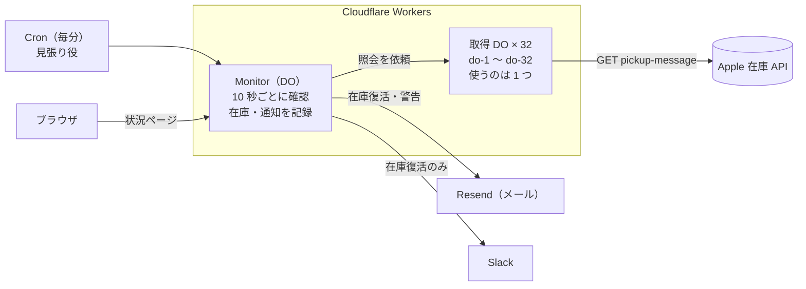
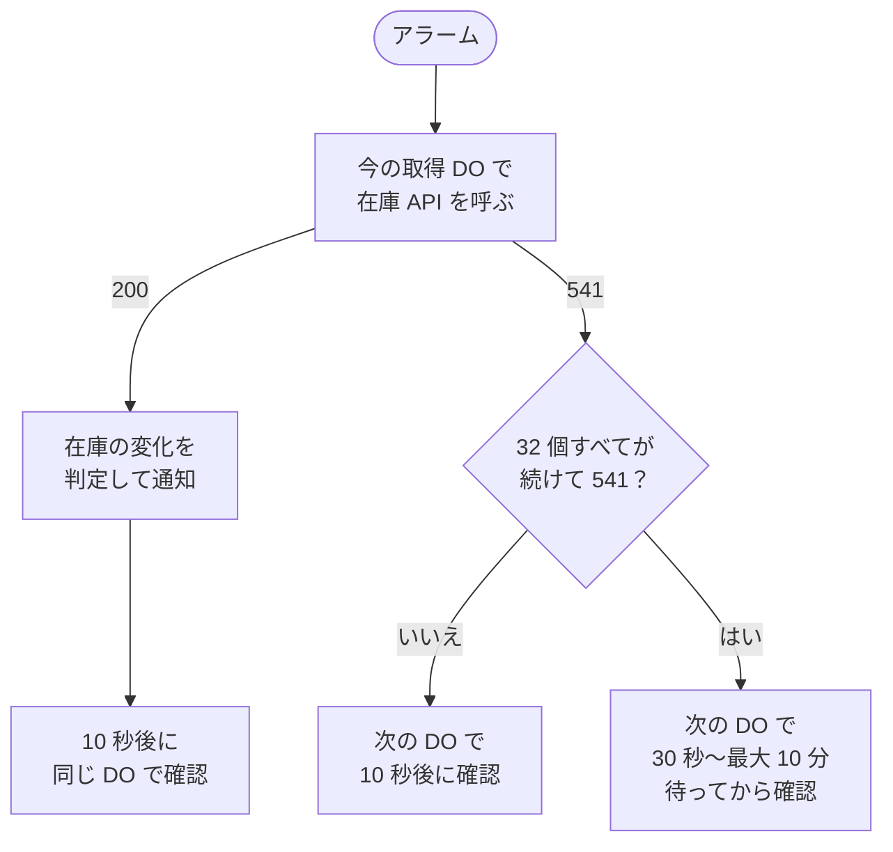
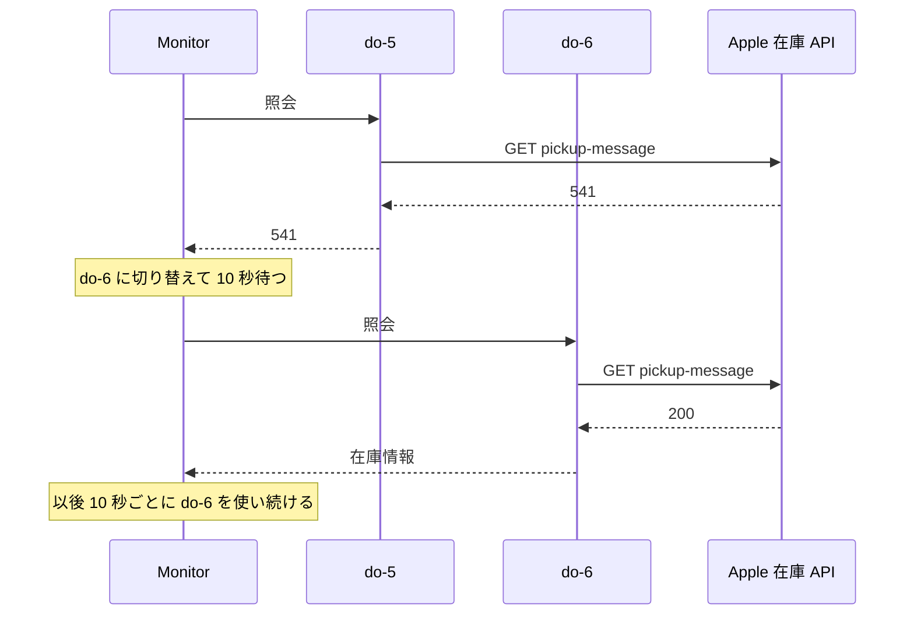

# duo-checker

Apple Store（日本）の **iPhone Duo（SIM フリー）の店頭受け取り在庫** を Cloudflare Workers 上で 10 秒ごとに確認し、在庫が復活したらメールと Slack で知らせるツールです。PC を起動しておく必要はありません。

- 指定した店舗のどれかで「在庫なし → 在庫あり」に変わったときだけ通知する（在庫ありが続く間は再通知しない）
- 在庫を確認するだけで、購入やバッグへの追加はしない
- Apple の在庫 API が返す **HTTP 541** に対しては、在庫を取りに行く Durable Object（DO）を切り替えて監視を続ける（[詳しく](#http-541-への対処)）

> [!WARNING]
> Apple の[サイト利用規約](https://www.apple.com/jp/legal/internet-services/terms/site.html)は、自動化された手段でサイトにアクセス・監視することを禁じています。実験目的のツールなので、使う場合は自己責任でお願いします。

Mac の Safari 経由で確認する以前の版は [`mac-safari` ブランチ](../../tree/mac-safari) にあります。

## 全体の仕組み



- **Monitor** は全体で 1 つだけの DO です。10 秒ごとのアラームで在庫を確認し、在庫の記録・通知履歴・未送信のメールを自分のストレージに保存します。1 か所で動くので、二重に確認したり二重に通知したりしません。
- **取得 DO** は、Apple の在庫 API を実際に呼ぶ役です。32 個ありますが、使うのは常に 1 つです。541 が返ったときだけ次の DO に切り替えます。
- **Cron** は毎分動く見張り役です。アラームが止まっていたら起動し直します。
- 在庫 API は近くの店舗の在庫もまとめて返します。首都圏 6 店舗なら 1 回の照会で、全国 11 店舗でも 3 回（丸の内・名古屋栄・福岡）で確認できます。

## HTTP 541 への対処

### 541 とは

- Apple の在庫 API がときどき返す、標準にないステータスコードです。本文は HTML で、`Retry-After`（いつ再試行してよいか）は付いていません。
- 541 が返った回は在庫が分かりません。放っておくと、その間に在庫が復活しても気づけません。
- いつ、なぜ返るのかは公開されておらず、まだ特定できていません（[観測記録](#観測記録)）。

### 対処の方針

- **リクエストは偽装しない。** User-Agent の書き換え、Cookie の使い回し、ヘッドレスブラウザなどは使わず、普通のヘッダーで API を呼ぶだけです。
- **541 が返ったら、次の取得 DO に乗り換える。** 取得 DO は do-1 〜 do-32 の 32 個で、普段は 1 つを使い続けます。乗り換えた DO では、いつもと同じ 10 秒後に確認します。
- **リクエスト数は増やさない。** 32 個に同時に照会するわけではありません。541 が続いているときも含めて、Apple への確認は 10 秒に 1 回までです。
- **全部だめなら待つ。** 32 個すべてが続けて 541 を返したら、Apple に照会し続けないよう間隔を空けます。

### 1 回の確認の流れ



541 が続いたときの待ち時間は次のとおりです。200 が返れば、すぐ 10 秒間隔に戻ります。

| 連続した 541 の回数 | 次の確認 |
|---|---|
| 1〜31 回 | 10 秒後に、次の DO で |
| 32 回（全 DO が一巡） | 30 秒後 |
| 64 回 | 1 分後 |
| 96 回 | 2 分後 |
| 128 回 | 4 分後 |
| 160 回 | 8 分後 |
| 192 回以降 | 10 分ごと（上限） |

### 例: 541 が返ったときのやりとり



### 541 のあいだの扱い

- その回の照会は打ち切り、残りの店舗には照会しません。
- 在庫の記録は書き換えません。そのため、復旧した直後に「在庫復活」と誤って通知することはありません。
- 在庫を取得できない状態が 10 分続いたら警告メールを、取得できるようになったら復旧メールを送ります。
- 状況ページの `recentChecks` に `10:21:54 541 [do-5]` のように残ります。541 の直後の DO で 200 に戻っているかを、ここで確かめられます。

### 観測記録

- 購入ページが使う `fulfillment-messages` は、Workers から呼ぶと 541 が返ります。店頭受け取り用の `pickup-message` は普段 200 が返るので、こちらを使っています。
- 2026-10-17 15:33 の 541 の応答は、`text/html`・127,974 文字・52 ms で、`Retry-After` はなく、`Server: cloudflare` と末尾が `KIX` の `cf-ray` が付いていました。Cloudflare を通った応答ですが、541 を作ったのが Cloudflare か Apple かはヘッダーだけでは分かりません。
- 2026-10-17 に配置ヒントで DO を東京・シンガポール・欧州に置いたところ、同じ照会は NRT・SIN・CDG のどれでも 200 でした。Cloudflare の trace で見た出口 IPv6 はどの拠点も同じでした。
- 2026-10-18 10:02（DO 8 個、541 のたびに 10 秒ずつ長く待つ旧方式）: do-8・do-1・do-2・do-3 が続けて 541 を返し、最初の 541 から約 100 秒後に do-4 で 200 に戻りました。
- 2026-10-18 10:21（DO 32 個、541 の約 1 秒後に次の DO へ切り替えていた時期）: do-5 の 541 の約 1 秒後に、do-6 で 200 に戻りました。ただし、これは一連の 541 が始まってから約 100 秒後でもありました。
- DO を切り替えたから戻ったのか、時間がたったから戻ったのかは、まだ切り分けられていません。541 の直後の DO で 200 が返る例が増えるかを見ています。

## 必要なもの

- [Cloudflare](https://dash.cloudflare.com/sign-up) のアカウント（無料プランで動きます）
- [Resend](https://resend.com/) のアカウント（メール送信用。無料で 1 日 100 通まで）
- Node.js 20 以上
- Slack に通知する場合は、通知先チャンネルの Incoming Webhook URL

## セットアップ

**1. 取得してインストールする**

```sh
git clone git@github.com:toyoshin5/duo-checker.git
cd duo-checker
npm install
```

**2. Resend の API キーを作る**

Resend にサインアップし、[API Keys](https://resend.com/api-keys) で「Create API Key」を押してキー（`re_` で始まる文字列）をコピーします。

**3. `config.ts` を書き換える**

```ts
colors: ["starwhite"],        // "starwhite"（スターホワイト） / "nightsky"（ナイトスカイ）。複数可
capacities: ["256gb"],        // "256gb" / "512gb" / "1tb" / "2tb"。複数可
mailTo: ["you@example.com"],  // 通知先。複数可
stores: "all",                // 全国 11 店舗。絞るなら ["R718", "R079"] のように
intervalSeconds: 10,          // 確認間隔（秒、10 以上）
```

| 地域 | 店舗番号 |
|---|---|
| 首都圏 | R718 丸の内 / R079 銀座 / R224 表参道 / R128 新宿 / R119 渋谷 / R710 川崎 |
| 名古屋・関西 | R005 名古屋栄 / R711 京都 / R768 梅田 / R091 心斎橋 |
| 福岡 | R048 福岡 |

同じ地域の店舗は 1 回の照会でまとめて取れます。1 つの地域に絞ると、照会は 1 回の確認につき 1 回で済みます。

省略できる設定もあります。

| 設定 | 既定値 | 意味 |
|---|---|---|
| `enabled` | `true` | `false` にすると監視を止める |
| `intervalSeconds` | `30` | 確認間隔（秒、10 以上） |
| `errorAlertMinutes` | `10` | 在庫を取得できない状態がこの分数続いたら警告メールを送る |
| `mailFrom` | `duo-checker <onboarding@resend.dev>` | 送信元。Resend で独自ドメインを認証したら変えられる |

Resend で独自ドメインを認証していない場合、`mailTo` には **Resend に登録したメールアドレス** しか指定できません。

**4. デプロイして秘密情報を登録する**

```sh
npx wrangler login                          # ブラウザで Cloudflare にログイン
npm run deploy                              # config.ts を検証してからデプロイ
npx wrangler secret put RESEND_API_KEY      # 2 でコピーしたキーを貼り付ける
npx wrangler secret put SLACK_WEBHOOK_URL   # Slack に通知する場合だけ
```

デプロイ時に表示される `https://duo-checker.<アカウント名>.workers.dev/` を開くと、すぐに監視が始まります（開かなくても 1 分以内に始まります）。

**5. 通知が届くか確かめる（任意）**

```sh
cp .dev.vars.example .dev.vars   # .dev.vars に API キーを書く（git 管理外）
npm run test-email               # テストメールを 1 通送る
npm run simulate                 # 在庫を なし→あり→あり→なし→あり と変化させ、2 通だけ届くか確かめる
```

## 通知

| 種類 | メール | Slack |
|---|---|---|
| 在庫復活 | ○ | ○ |
| 在庫を取得できない状態が続いた（警告） | ○ | − |
| 取得できるようになった（復旧） | ○ | − |

在庫復活の通知は次のような内容です。同じ確認で複数の店舗が復活したら 1 通にまとめます。Slack では、URL が「購入ページ」「バッグ」というリンクとして表示されます。

```
件名: 【在庫あり】丸の内ほか1店舗 iPhone Duo 256GB スターホワイト

店頭受け取りの在庫があります（2026-10-17 10:00:00 確認）

■ iPhone Duo 256GB スターホワイト（SIMフリー）
・Apple 丸の内（R718） 受け取り: 本日
・Apple 福岡（R048） 受け取り: 本日
購入ページ: https://www.apple.com/jp/shop/buy-iphone/iphone-duo/…

バッグ: https://www.apple.com/jp/shop/bag
```

## 使い方

| やりたいこと | 方法 |
|---|---|
| 設定を変える | `config.ts` を書き換えて `npm run deploy` |
| 状況を見る | `https://duo-checker.<アカウント名>.workers.dev/` を開く |
| DO の動いている拠点を見る | 状況ページの URL に `?egress` を付けて開く |
| 新しい DO 2〜3 個で同時に照会して比べる | `/probe` を開く（5 分に 1 回まで。本番の監視には影響しない） |
| ログをリアルタイムで見る | `npm run tail` |
| 過去のログを見る | Cloudflare ダッシュボードの Workers & Pages → duo-checker → Logs |
| この PC から 1 回だけ確認する | `npm run check-once`（Workers を通さず、メールも送らない） |
| 一時停止する | `config.ts` で `enabled: false` にして `npm run deploy` |
| 完全にやめる | `npx wrangler delete` |

状況ページの主な項目は次のとおりです。

| 項目 | 内容 |
|---|---|
| `apple` | 直近の確認のステータスと取得 DO（例: `200 [do-6] 正常（10:28:25 の確認）`） |
| `recentSummary` | 直近 50 回のうち 200 と 541 が何回だったか |
| `recentChecks` | 直近 50 回の推移（例: `10:21:54 541 [do-5]`） |
| `health` | 連続失敗回数、連続 541 回数、失敗が始まった時刻 |
| `nextCheckInSeconds` | 次の確認までの秒数 |
| `recentNotifications` | 直近 10 件の通知の送信結果 |

## エラーと自動復旧

| 状況 | 対応 |
|---|---|
| HTTP 541 | その回の照会をやめ、在庫の記録は変えない。10 秒後に次の DO で確認する。32 個すべてが続けて 541 なら、一巡ごとに 30 秒、1 分、2 分…最大 10 分待つ |
| 通信エラーなど | その回の照会をやめる。DO は切り替えず、失敗が続いたら確認間隔を 10 秒 → 20 秒 → 40 秒 …最大 10 分まで延ばす |
| 取得できない状態が 10 分続いた | 警告メールを送る。取得できるようになったら復旧メールを送る |
| メールを送れなかった | 次の確認で再送する。失敗が続いたら間隔を延ばし（最大 30 分）、1 日たったら諦める。冪等キーで二重送信を防ぐ |
| Slack に送れなかった | ログに残すだけで、確認とメールは止めない |
| アラームが止まった | 毎分の Cron が起動し直す |

Workers Logs の `apple-http` には、HTTP ステータス、応答時間、本文の長さ、`Date`・`Retry-After`・`Server`・`Via`・`cf-ray` を記録します。応答本文や Cookie の値は記録しません。

## 無料枠の目安（10 秒間隔）

| 項目 | 無料枠 | 使用量の目安 |
|---|---|---|
| Workers のリクエスト | 10 万回/日 | Cron 1,440 回/日と状況ページを開いた回数 |
| DO のリクエスト | 10 万回/日 | 首都圏 6 店舗で約 1.9 万回/日、全国 11 店舗で約 3.6 万回/日 |
| DO の稼働時間 | 13,000 GB 秒/日 | Apple の応答時間による |
| 1 回の CPU 時間 | 10 ミリ秒 | 1〜4 ミリ秒（実測） |
| Workers Logs | 20 万件/日（3 日保存） | 10 秒間隔なら十分に収まる |
| Resend | 100 通/日 | 在庫復活と警告のときだけ |

## 開発

```sh
npm test            # テスト
npm run typecheck   # 型チェック
npm run dev         # ローカルで実行（手元からの照会は Apple に 403 で拒否されることがある）
```

| ファイル | 役割 |
|---|---|
| `config.ts` | 利用者が書き換える設定 |
| `src/index.ts` | エントリポイント。Monitor と取得 DO、DO の切り替え、状況ページ |
| `src/monitor.ts` | 1 回分の確認（在庫の取得、変化の判定、通知、待ち時間の計算） |
| `src/apple.ts` | 在庫 API の呼び出しと応答の解析 |
| `src/notify.ts` | メールと Slack の文面、送信 |
| `src/catalog.ts` | モデル・カラー・容量・店舗の一覧 |
| `src/config.ts` | 設定の検証 |
| `scripts/` | `check-once`・`test-email`・`simulate`・`validate-config` |
