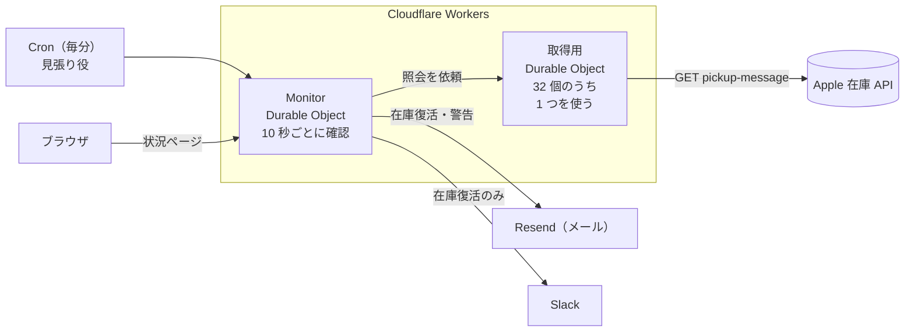
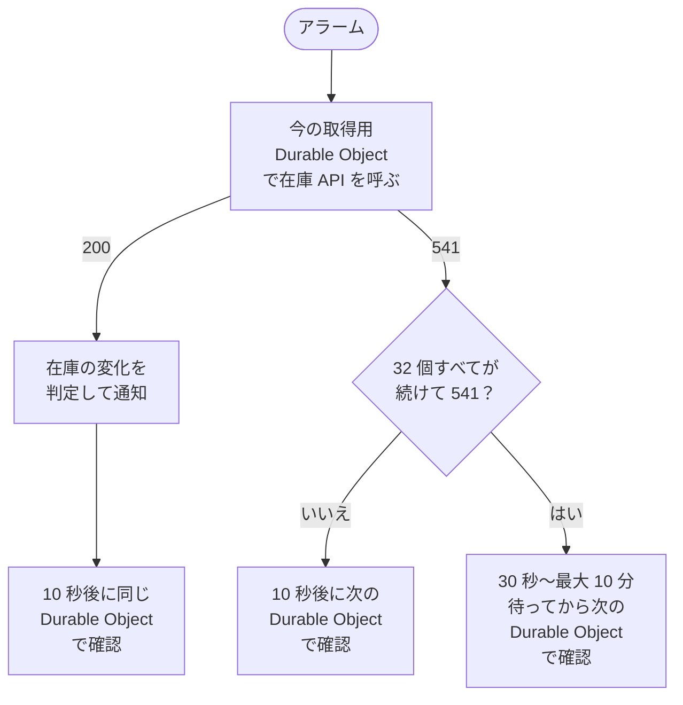
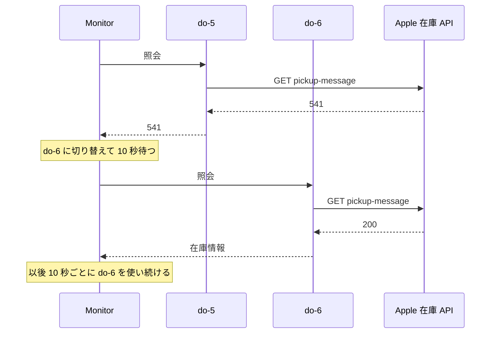

# duo-checker

Apple Store（日本）の **iPhone Duo（SIM フリー）の店頭受け取り在庫** を Cloudflare Workers で 10 秒ごとに確認し、在庫が復活したらメールと Slack で知らせます。購入やバッグへの追加はしません。

## 仕組み



Monitor が 10 秒ごとに在庫を確認し、在庫なしから在庫ありに変わった店舗だけを通知します。Apple への照会は、32 個ある取得用 Durable Object のうち 1 つが行います。

## HTTP 541 への対処

Apple の在庫 API は、ときどき標準にないステータス **541** を返します。541 の回は在庫が分からず、原因も公開されていません。

そこで、541 を返した取得用 Durable Object から次の Durable Object に切り替えて確認を続けます。状況ページでは、32 個を `do-1`〜`do-32` と表示します。





- 541 が続いても、Apple への確認は 10 秒に 1 回までです。User-Agent や Cookie の偽装はしません。
- 在庫を取得できない状態が 10 分続くと警告メールを、戻ると復旧メールを送ります。

## セットアップ

必要なもの: [Cloudflare](https://dash.cloudflare.com/sign-up) と [Resend](https://resend.com/) のアカウント（どちらも無料プランで動きます）、Node.js 20 以上

```sh
git clone git@github.com:toyoshin5/duo-checker.git
cd duo-checker
npm install
```

`config.ts` を書き換えます。

```ts
colors: ["starwhite"],        // "starwhite" / "nightsky"
capacities: ["256gb"],        // "256gb" / "512gb" / "1tb" / "2tb"
mailTo: ["you@example.com"],  // Resend に登録したアドレス（独自ドメイン未認証の場合）
stores: "all",                // 全国 11 店舗。絞るなら ["R718", "R079"] のように
intervalSeconds: 10,          // 確認間隔（秒）
```

| 地域 | 店舗番号 |
|---|---|
| 首都圏 | R718 丸の内 / R079 銀座 / R224 表参道 / R128 新宿 / R119 渋谷 / R710 川崎 |
| 名古屋・関西 | R005 名古屋栄 / R711 京都 / R768 梅田 / R091 心斎橋 |
| 福岡 | R048 福岡 |

デプロイして、API キーを登録します。

```sh
npx wrangler login
npm run deploy
npx wrangler secret put RESEND_API_KEY      # Resend の API Keys で作ったキー
npx wrangler secret put SLACK_WEBHOOK_URL   # Slack に通知する場合だけ
```

`https://duo-checker.<アカウント名>.workers.dev/` を開くと監視が始まります。`npm run test-email` でテストメールを送れます（`.dev.vars.example` を `.dev.vars` にコピーしてキーを書く）。

## 使い方

| やりたいこと | 方法 |
|---|---|
| 状況を見る | `https://duo-checker.<アカウント名>.workers.dev/` を開く（`recentChecks` に直近 50 回の結果） |
| 設定を変える | `config.ts` を書き換えて `npm run deploy` |
| ログを見る | `npm run tail` |
| 一時停止する | `config.ts` で `enabled: false` にして `npm run deploy` |
| 完全にやめる | `npx wrangler delete` |

## 開発

```sh
npm test
npm run typecheck
```
